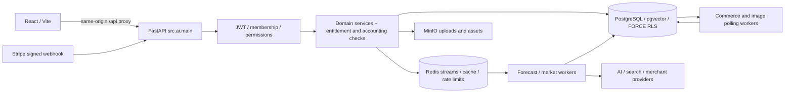

# Unified runtime architecture

The Python backend is the sole identity, billing, entitlement, credit and canonical-data authority. The original Node implementation is a behavioral reference, not a runtime dependency.

## Code boundaries

- `backend/src/ai/main.py`: app wiring, CORS, exception middleware, lifecycle tasks.
- `src/ai/routers/`: authenticated HTTP contracts.
- Domain packages (`billing`, `pricing`, `forecasting`, `rag`, `marketing`, etc.): services, data access and orchestration.
- `src/ai/db.py` and `src/infrastructure/db_pool.py`: restricted-role connections and transaction-local tenant context.
- `src/market_scraper/`: existing workers, source policy, adapters, collection, commerce staging and canonical-review integration.
- `frontend/src/shared/lib/httpClient.js`: browser API transport; feature adapters connect pages to Python.

## Authentication and authorization

Signup/OTP/login issue the existing JWT/session state. Tenant membership, role and entitlements are revalidated in Python. A tenant administrator does not become a Platform Owner. RLS complements HTTP authorization; it does not replace it.

Local development does not seed privileged accounts or bypass guards. Mailpit captures the application's real verification email locally.

## Manual business import

Frontend upload → extraction router validation/type/size checks → source and ingestion job → existing extraction/background processing → durable staging and row errors → authenticated preview/confirmation → canonical product/invoice/inventory services → dashboard consumers.

Knowledge documents follow the RAG ingestion/indexing flow and storage policy. They are not silently promoted into business tables. No additional ingestion daemon is invented by the developer launcher.

## Commerce synchronization

Tenant-configured Shopify/WooCommerce connection → provider validation/adapter → connector polling/webhook intake → durable provider staging → identity/conflict review → explicitly authorized canonical services → receipts, provenance and audit.

Automatic promotion remains off by default. Conditional catalog automation and inventory mappings retain their approved safety gates. Automatic invoice posting remains blocked pending accounting decisions. Local startup enables none of these flags and contacts no merchant store automatically in a fresh DB.

## AI recommendation and evidence

React feature action → Python authentication/entitlement checks → usage/Credit reservation → existing model/service orchestration → result/history/evidence persistence → settlement and customer response. Forecast requests use the existing Redis consumer. Image jobs are claimed from PostgreSQL and heartbeat there.

Algorithms, model mathematics and financial charging units are unchanged by developer tooling. Missing libraries, weights, credentials or confirmed provider rates remain real feature limitations.

## Payments

Customer action → Python Checkout/quote authority → Stripe → exact-body signed `/billing/webhook` → idempotent reconciliation → subscription/entitlement snapshots and credit accounting → customer UI.

Local setup does not create a Checkout session or fake a webhook. Stripe CLI testing is an explicit opt-in external activity.

## Readiness

`/health` is process liveness. `/health/ready` checks PostgreSQL as the restricted app role and Redis. Developer startup also checks migration coverage, pgvector, RLS, CORS, storage/mail container health, worker initialization and Vite's real API proxy. These checks establish local runtime readiness, not external-provider or paid-feature certification.
