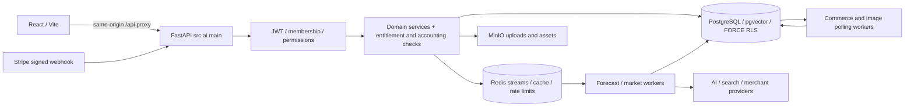

# How KEEL works

The Python backend is the sole identity, billing, entitlement, credit and canonical-data authority. The original Node implementation is a behavioral reference, not a runtime dependency.

## Code boundaries

- `backend/src/ai/main.py`: app wiring, CORS, exception middleware, lifecycle tasks.
- `src/ai/routers/`: authenticated HTTP contracts.
- Domain packages (`billing`, `pricing`, `forecasting`, `rag`, `marketing`, etc.): services, data access and orchestration.
- `src/ai/db.py` and `src/infrastructure/db_pool.py`: restricted-role connections and transaction-local tenant context.
- `src/market_scraper/`: existing workers, source policy, adapters, collection, commerce staging and canonical-review integration.
- `frontend/src/shared/lib/httpClient.js`: browser API transport; feature adapters connect pages to Python.

Frontend route composition lives in `frontend/src/app/router/`; pages, hooks and
API adapters live under `frontend/src/features/`. TanStack Query manages server
queries/mutations and invalidation; Zustand/shared session state supports browser
state. The HTTP client handles the existing Python session contract. Vite's
local `/api` proxy points at the exact checkout API; the browser has no database
or provider secret. English/Arabic locale resources and RTL direction belong to
the frontend, while authorization and entitlement decisions belong to Python.

## Authentication and authorization

Signup/OTP/login issue the existing JWT/session state. Tenant membership, role and entitlements are revalidated in Python. A tenant administrator does not become a Platform Owner. RLS complements HTTP authorization; it does not replace it.

Local development does not seed privileged accounts or bypass guards. Mailpit captures the application's real verification email locally.

PostgreSQL FORCE row-level security protects tenant-owned tables even when a
query accidentally omits a tenant filter. Connection wrappers restore transaction
context after commit/rollback; runtime roles have neither superuser nor BYPASSRLS.
Migration authority is separate from `ceopro_app`, Checkout coordination,
signed-webhook reconciliation and credit-accounting identities. See
[database roles](DATABASE.md#credentials-and-roles) for their exact responsibilities.

## Manual business import

Frontend upload → extraction router validation/type/size checks → source and ingestion job → existing extraction/background processing → durable staging and row errors → authenticated preview/confirmation → canonical product/invoice/inventory services → dashboard consumers.

Knowledge documents follow the RAG ingestion/indexing flow and storage policy. They are not silently promoted into business tables. No additional ingestion daemon is invented by the developer launcher.

## Commerce synchronization

Tenant-configured Shopify/WooCommerce connection → provider validation/adapter → connector polling/webhook intake → durable provider staging → identity/conflict review → explicitly authorized canonical services → receipts, provenance and audit.

Automatic promotion remains off by default. Conditional catalog automation and inventory mappings retain their approved safety gates. Automatic invoice posting remains blocked pending accounting decisions. Local startup enables none of these flags and contacts no merchant store automatically in a fresh DB.

## AI recommendation and evidence

React feature action → Python authentication/entitlement checks → usage/Credit reservation → existing model/service orchestration → result/history/evidence persistence → settlement and customer response. Forecast requests use the existing Redis consumer. Image jobs are claimed from PostgreSQL and heartbeat there.

Algorithms, model mathematics and financial charging units are unchanged by developer tooling. Missing libraries, weights, credentials or confirmed provider rates remain real feature limitations.

The RAG path stores uploaded documents, extracts tenant-scoped chunks, retrieves
relevant evidence and builds a grounded prompt. Optional local embedding/reranking
models improve retrieval; an external LLM generates a cited response. Current
all-history invoice context is separate from fixed-window summaries. Marketing
drafts undergo source-grounding review before persistence; images are asynchronous
PostgreSQL jobs whose assets are stored in MinIO. Neither generated prose nor a
generic image becomes independently verified business evidence.

Feature allowances, Data Credits, AI Credits and provider USD cost are separate
controls. Before a paid provider request, accounting requires an attributed tenant,
valid access, available budget, approved rates and a reservation. Settlement
records measured cost and consumes Credits under the existing policy. Unknown
rates fail closed; they are never zero by omission. Installation migrations
bootstrap the approved versioned AI rate catalog without repricing configured
schedules or rewriting historical costs.

## Payments

Customer action → Python Checkout/quote authority → Stripe → exact-body signed `/billing/webhook` → idempotent reconciliation → subscription/entitlement snapshots and credit accounting → customer UI.

Local setup does not create a Checkout session or fake a webhook. Stripe CLI testing is an explicit opt-in external activity.

Signed event authentication, customer/tenant association, replay handling and
payment evidence precede activation. A Checkout redirect, planned downgrade,
draft invoice or zero-value trial invoice cannot manufacture paid entitlement.
Existing trial dates, immutable entitlement snapshots and credit boundaries
survive ordinary restarts and plan transitions.

## Notifications and scheduled work

The API lifespan runs discovery refresh scheduling, notification digest polling
and stale credit-reservation upkeep. Notification preferences and delivery state
persist in PostgreSQL; `core/notifications.py` sends through SMTP (Mailpit locally).
The eight separately launched workers and their queues/health signals are listed
in [Workers](WORKERS.md). A ready scheduler/worker is not proof of successful
provider work or delivered email.

## Readiness

`/health` is process liveness. `/health/ready` checks PostgreSQL as the restricted app role and Redis. Developer startup also checks migration coverage, pgvector, RLS, CORS, storage/mail container health, worker initialization and Vite's real API proxy. These checks establish local runtime readiness, not external-provider or paid-feature certification.

Use the [feature map](FEATURES.md) to locate implementation and bounded acceptance
limits, and [Testing](TESTING.md) to verify business outcomes. Maintainers needing
the approved security/financial rationale can follow the
[decision register](keel-integration/DECISION_REGISTER.md); these historical
identifiers are reference labels, not an alternative application architecture.
