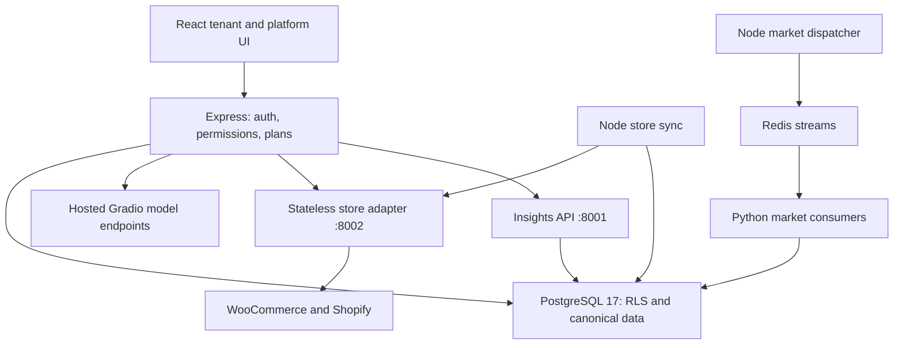

# Architecture

> **18 October review update:** the custom competitor bridge and dependent Smart Alerts UI are suspended. The current team competitor source is restored unchanged. Earlier descriptions of active custom tracking below are historical. See [current review instructions](COMPETITOR_REVIEW.md).

## Active application boundary

The diagram separates provider calls from database writes. Store HTTP requests run outside DB transactions; Node then validates and commits a bounded page under a tenant context. Stable external identifiers and source-scoped line keys prevent repeat-sync duplication. Source leases coordinate workers. Inventory observations preserve unknown stock separately from zero. Paid invoices and sales transactions serve different metrics.

## Tenant and security boundary

`backend/src/config/database.ts` initializes Prisma's PostgreSQL adapter. Repositories set transaction-local tenant/user context; PostgreSQL policies enforce isolation even when a query omits an application filter. `ceopro_app` is restricted. Dedicated ingestion, dispatcher and notification roles have narrowly scoped functions; none should be superuser or BYPASSRLS. A migration administrator is a distinct operator credential.

JWT access/refresh tokens and persisted sessions are Node concerns. Permission checks and feature entitlements precede provider calls and canonical mutations. Python insights validates Node tokens, request signatures, active sessions and tenant membership before using `ceopro_app`. Collector actors need genuine tenant authorization; a UUID alone does not grant access. Python standalone authentication/billing modules still exist, but are outside this application boundary.

## Durable work and integrations

Node database outboxes/schedules are the source of truth for approval and dispatch. Redis stream delivery is asynchronous and can retry. A Redis publication is not collection completion. Python discovery proposes candidates; users confirm product equivalence and approve eligible website sources before scheduling collection. Numeric observations require product/currency/freshness checks before pricing, alerts or recommendations use them. Robots restrictions, blocked requests and cost policy failures remain visible rather than being converted into invented prices.

Stripe receives raw signed webhook bodies at `/stripe/webhooks`; browser checkout return alone is not payment confirmation. Shopify's raw-body webhook route is `/integrations/shopify/webhooks`; OAuth callback is `/integrations/shopify/callback`. WooCommerce is polled through REST v3, with no Woo webhook receiver in this release.

RAG stores tenant documents and a PostgreSQL text search index, ranks across indexed documents and sends selected evidence to the provider. The local Python RAG implementation also has embeddings/reranking and optional web fallback, but the deployed Gradio wrapper is external to this repository. Never assume a local FastAPI route is a compatible replacement for a Node Gradio contract.

## Storage and retained history

Prisma migrations in `backend/prisma/migrations` own the shared database schema. `prisma/base-schema.sql` duplicates the historical baseline and must not be preloaded before `migrate deploy`. Python migrations are for its separate standalone deployment, not an additional migration chain for KEEL_DEV. MinIO stores Python generated summaries/documents where configured; canonical Node document storage has its own repository and quotas.

`reference/`, `ai/docker-compose.yml` and `backend/docker-compose.yaml` are preserved historical/standalone entry points. Starting those stacks alongside root Compose can select different volumes/databases and duplicate ports. Root Compose is the supported integrated development infrastructure.
