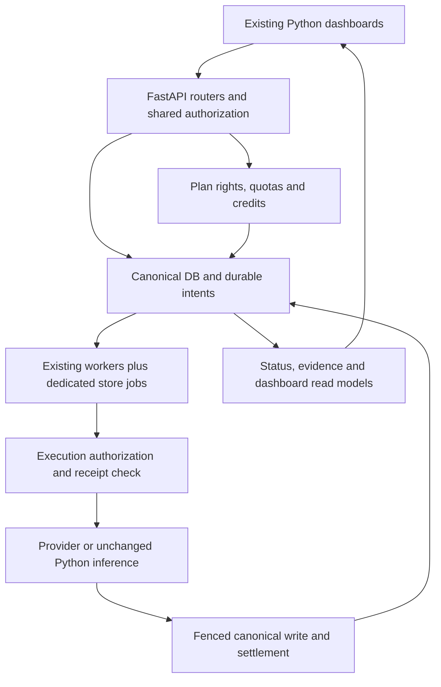

> Phase 0R: read [SOURCE_TRACE_CORRECTIONS.md](SOURCE_TRACE_CORRECTIONS.md) and [PHASE0R_README.md](PHASE0R_README.md) before relying on original source-inference wording. Native/runtime gates remain pending.

# Dependency and schema ownership map

Paths below are relative to Python `CEOPRO-AI/` unless prefixed Node. `evidence/SQL_OBJECT_LINEAGE.csv` gives exact migration paths, statement lines, policies/grants/triggers/functions for both source trees, including historical changes. A table's first CREATE statement alone is insufficient: later migrations can supersede constraints/grants/catalog values.

## Authoritative owners and persistence

| Capability | Canonical Python owner and state | Dependency and migration lineage | Required invariants |
|---|---|---|---|
| Identity/tenant | routers/auth.py, core/security.py, db.py; users, companies, tenant_users; verification/reset/invitation tables | Final_schema.sql; 20260915020000_add_auth_lookup_functions; 20260919000000_add_auth_completeness; 20261011000000/100 email/join; 20261020000000 auth_join_tenant | One Python issuer; active membership; signup uniqueness; no recursive perimeter policy; no customer connection with BYPASSRLS |
| Plans/grants | billing/store.py, core/usage.py, core/entitlements.py; usage_plans, usage_features, usage_plan_limits, usage_plan_entitlements, tenant_plan_assignments | 20261007000000_add_usage_plans; 20261009000000_add_billing; 20261013000000_agreed_plan_limits; 20261020000000_keel_subscriptions_and_credits; 20261021000000_pro_plan_limits_500_products_50_seats | Distinguish plan key/display label; historic price/grants preserved; effective rights snapshot; explicit missing versus unlimited |
| Stripe/history | billing/webhooks.py, store.py, stripe_api.py; billing_customers, billing_subscriptions, billing_plan_prices, billing_payments, billing_webhook_events (verify final table definitions via SQL index) | billing migration and Task 6 source patch; store catalog/resolve_price/current_subscription/record_payment/apply_subscription | Tenant customer/subscription ownership; one current assignment; invoice monotonicity; retry/idempotency/advisory lock ordering |
| SUM/MAX usage | core/usage.py; tenant_usage_counters, metered_request_keys; live products/tenant_competitors/tenant_users/data_sources/storage rows | usage migration plus 20261024000000_report_request_identity | Positive integer amount; period/actor/fingerprint/receipt binding; atomic last slot; stale release cannot undo successor |
| Credit and provider money | billing/credits.py/admin.py/maintenance.py; billing_cost_policy, provider_cost_schedules, provider_spend_controls, tenant_credit_balances, usage_ledger, usage_ledger_adjustments, metered_request_keys | 20261020000000 credits migration; 20261022000000_free_image_provider_cost_rows; market_scraper cost_ledger/provider_billing and 20260915000000_add_scraping_cost_ledger | Separate credit units and USD; fail-closed unknown paid prices; append-only reconciliation; operator audit; conservative crash treatment |
| Custom contracts | billing/admin.py::set_custom_contract; tenant_custom_contracts, tenant_entitlement_overrides, entitlement_audit_log | credits migration and scripts/billing_admin.py | Existing approved manual activation retained; quote acceptance not equivalent to grant; cost data operator-only |
| Generic connections | routers/onboarding.py, onboarding router/market_scraper.data_access, market_scraper connector_sync/api_connector_sync/connector_worker; data_sources, encrypted credential vault, ingestion_jobs/import_staging_rows | initial schema/connector migrations; 20260912000000_add_connector_discovery_function; credential vault migrations (SQL index) | Restricted discovery; tenant source limits; public-target and read-only query guard; credentials never returned; staging is not canonical commit |
| Manual/business imports | routers/extraction.py, extraction/ingestion_pipeline.py/promotion.py; products, transactions, invoices, invoice_items, import_staging_rows, ingestion_jobs | Final_schema plus transactions/commit-target migrations; later invoice mirror/precision/product identity migrations (SQL index) | Atomic sale+invoice mirror; deterministic occurrence identity; barcode fill-only; row-level quarantine; no refund of already retained work by accident |
| Stock/products | routers/products.py, dashboard inventory helpers, extraction promotion, sales/quick_sale.py; products, inventory (warehouse_location) and invoice/items | Final_schema/product/inventory/quantity migrations; Node import-product and store inventory SQL supply missing ownership behavior | Active tenant catalog; SKU/ID/name consistency; source-owned stock; no double decrement; capacity locks |
| Reviews/sentiment/MPI | routers/reviews.py/sentiment.py/mpi.py, sentiment pipeline and mpi data/scoring/evidence; reviews, sentiment_results, evidence_records | 20260827010000_restore_review_subject_types; 20260827000000_restore_shared_evidence_architecture; review validation/safety migration lineage | Subject type+tenant ownership; COMPETITOR global ID mapping; allowed safe nonfuture dedup eligibility; UNKNOWN not zero |
| Pricing/market | routers/pricing.py; pricing pipeline/data_access/estimation/guardrails/evidence; products, competitor_product_mappings, competitor_prices, tenant_competitors, global_competitors, currency_rates, market observations, recommendation_outcomes, evidence_records | shared evidence migration; market-source/observations/competitor/FX migrations in SQL index | Approved provenance; explicit fallback/freshness/FX policy; finite monetary outputs; no automatic price mutation |
| Required notifications | existing core/notifications plus provider/email settings; new quote outbox/consumer to be added | Node sendCustomPlanQuote → tenantNotificationProducer and tenant notification workers; Python existing notifications remain | Domain state+outbox atomic; retry/idempotency; actor != worker identity; customer cost data excluded |

Some names above are conceptual groups; **authoritative actual table tokens** and exact statement locations are in PERSISTENCE_SURFACES.csv and SQL_OBJECT_LINEAGE.csv. Do not generate migrations by copying this table without querying the native schema. A later verification pass must reconcile it against pg_catalog/pg_policies and report all unresolved objects.

## Node migration behavior to carry, not apply

- `backend/prisma/migrations/20261017150000_woocommerce_connections/migration.sql`: persistent store connection/product/sale links, scheduler/service privileges, lifecycle/version state.
- `20261017180000_woocommerce_inventory_invoices/migration.sql`: stock/invoice/order item projections and external lineage.
- `20261017220000_shopify_store_connector/migration.sql`: shop identity, OAuth state, inventory locations, privacy reports/exclusions, webhook delivery dedup; restricted SECURITY DEFINER process_shopify_event and revocation trigger.
- `20261012020000_reviewable_business_imports/migration.sql`: reviewable draft imports; `20261014010000_import_sale_identities/migration.sql`: source sale identities; `20261015020000_pricing_request_integrity/migration.sql`: pricing request durability.
- Auth recursion fixes and platform RLS cycle fixes are security intent evidence. Existing applied Node/Prisma SQL must never run against Python main; write additive Python-native equivalents only after schema reconciliation.
- Node custom quote/promo schemas and vendor/infrastructure rates are represented by Prisma schema plus migration history; inspect `model CustomPlanQuote`, `CustomPlanQuoteFeature`, `VendorRate`, promo/plan links and indexes. No seed values are commercial authority.

## Complete main flows and dependent read models

Manual imports feed products/transactions for forecasts **and invoices/items for dashboard/chat**; store imports must produce coherent projections in both. Inventory flows feed product and demand views. Reviews feed sentiment_results then MPI; market approved source/mapping/prices feed pricing. Forecasting is a pricing dependency only for contextual holds and post-import refresh: preserve its pipeline/model, no wholesale rewrite.

## Job producers and consumers

| Existing source | Producer/consumer and state | Target integration obligation |
|---|---|---|
| market.scrape.requested | market_scraper/enqueue.py XADD; worker.py consumer group ceopro-market-scrapers, xautoclaim and market.scrape.dead | Preserve discovery/enrichment/price ingestion and cost gate; revalidate status/rights at execution; never create unrestricted stream publisher for customers |
| Generic connector schedule | connector_worker.py discovers tenants then connector_sync/api_connector_sync, poll default 300s | Preserve source/type failure isolation; add durable claim/actor/access check and canonical promotion contract |
| Extraction upload | routers/extraction.py creates ingestion job; process_records/promotion synchronous with bounded commits | Add durable continuation/review/retry without breaking existing response summary; classify retained partial work |
| Task 6 report export | reports.py + usage.reserve_request/release_request | Keep response/file contract and receipts; no full unbounded retry refund |
| Billing maintenance | main lifespan starts billing.maintenance thread; expire/reconcile reservations | Preserve recovery and ledger policy; avoid duplicate maintenance action in replicas through idempotency/locks |
| Node store worker reference | store-connectors.worker.ts due query, attempts<5, next_run/lease; products then orders pages | New Python collector owner, no Node process required; exact-once external record revision+checkpoint writes |
| Node quote notification reference | sendCustomPlanQuote transaction updates quote+producer event | Python durable outbox uses existing notification conventions and restricted consumer; no external messages sent during Phase 0 |

## Runtime dependencies and configuration

Use supplied `.env.example`, `RUNNING_LOCALLY.md`, `keel`, compose/render configuration and `scripts/check_config.py` as startup authorities. `evidence/ENVIRONMENT_DEPENDENCIES.csv` lists names and call sites without values. Minimum integration infrastructure: native PostgreSQL 17 with required extensions/grants, Redis with authentication/network access restricted, configured Python app/lookup/migration/service roles, object storage for retained files, vault master key, email transport for verification/offers and model dependencies for full API startup. Test identity must never point to KEEL_DEV/shared production.

Paid providers need verified schedules and budget/control rows before enabling actions. Stripe secret/webhook/test catalog and configured return origins; Shopify app ID/secret/redirect/scopes/API version/dev-store access; Woo REST sandbox credentials/public HTTPS test origin. No account or secret is assumed. The source's internal auth/worker/provider endpoints and Redis access must be inventoried from render/compose/ASGI/stream consumers before exposure; fixture HTTP tests are not a direct-service security certification.

## Migration and consistency strategy

Append-only DDL under existing migration runner. Use nullable additions/backfill/validate constraints before enforcing required fields; preserve existing grants and FORCE RLS; narrowly grant lookup/operator/service SQL and fix search_path. Runtime scoped connections reset tenant context at each transaction and after pool return. Native two-session tests must check function execution privileges, wrong-tenant read/write/subject lookup, concurrent capacity/keys and webhook assignment races. Do not trust SET ROLE tests alone to prove runtime password login privileges.

Back up/rehearse populated restore, compute old/new effective rights and invoice/transaction/stock totals; stop if identities conflict. New features stay disabled until migrations, API, worker and UI agree. Old/new report-key source cannot run concurrently during Task 6 schema switch. After new external IDs/period keys exist, rollback by disabling new collectors/entrypoints and repairing forward; never delete history to force an obsolete unique key.
