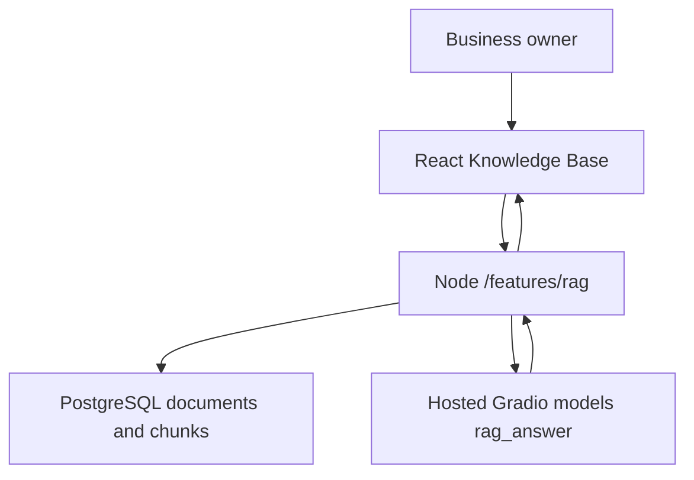

# RAG Assistant (`rag_assistant`) testing and diagnostics

This suite audits the real CEOPRO Knowledge Base flow and the distinct AI-team RAG implementation. It reuses `backend/playwright.config.ts`, the shared HTML/JSON reporters, failure screenshots/traces, Node `node:test` conventions, the Gradio client, and Python RAG unit tests. It does not introduce another testing framework.

## Verified architecture and owners



The active web query is Node's `POST /features/rag/query`, which sends up to ten tenant-filtered documents to the hosted Gradio `models/rag_answer` API. Plain text and Markdown are sent as text; PDF, DOCX, and XLSX bytes are Base64 encoded. Node maps returned source names to local IDs, stores cited passages in tenant-owned `rag_document_chunks`, then charges reported tokens. The Node adapter enforces a 120-second timeout and validates request/response schemas.

The AI team's `POST /rag/query` is a separate FastAPI pathway. It queries persisted tenant chunks and embeddings using BM25 + dense vector retrieval, rank fusion, optional reranking, evidence assembly, and a separately configured LLM client. Its MinIO/document-ingestion/indexing path is not called by the active Node web query/upload implementation in this checkout. Testing AI FastAPI does **not** prove the frontend's hosted Gradio path works.

| Component | Current ownership and behavior |
| --- | --- |
| React Knowledge Base | Lists/uploads files, submits one question, renders source list and evidence panel. Session listing is a stub; messages are transient in component state. |
| Node route/controller/service | Tenant auth; upload/list use `document_extraction`; query/citation details use `rag_assistant`; invokes hosted Gradio and maps citations/usage. |
| Node PostgreSQL repository | Stores source bytes in `rag_documents_metadata.source_file_content` BYTEA; RLS context is set transaction-locally. Cited chunks are inserted on demand. |
| Hosted Gradio Space | Active web query service. Its server implementation is not in the checked AI repository; its retrieval internals and answer quality need live verification. |
| AI-team FastAPI | Independent indexed retrieval/API using DB chunks, embeddings, hybrid retrieval, reranking, and its own LLM contract. |
| Billing/features | `rag_assistant` is cumulative token usage reset by billing period; `document_extraction` is a separate KB upload meter; `document_storage_mb` is retained capacity. |

## Source-audited findings

- Standard plan limits in the checked production plan are Starter **100,000**, Growth **500,000**, and Enterprise **2,000,000** `rag_assistant` tokens per billing period. Effective limits come from persisted subscription plan features; custom-plan and lifecycle E2E still require DB fixtures.
- Node upload/list require `document_extraction`; uploads also check storage capacity. Chat requires `rag_assistant`, including direct API calls.
- Backend accepts TXT, Markdown, PDF, DOCX, XLSX up to **2 MiB**. The frontend upload client says **10 MiB**. Current backend validation checks extension/size/non-empty bytes, not actual signatures or parse validity.
- Upload saves BYTEA then immediately labels the record `Processed`; Node does not index on upload. The query later resends source bytes to Gradio. Thus upload-time `Processed` is not proof of pre-indexing. Gradio's own internal readiness behavior is unavailable in this repo.
- Query candidates are at most the ten newest `Processed` tenant documents, ordered by upload time then document ID descending. An older unique source can be omitted silently.
- Token charging prefers a provider total; otherwise it floors input/prompt + output/completion. Missing/malformed usage becomes zero and successful answers are charged only when the calculated amount is positive. The quota check is before generation; actual charging is after citation persistence. Concurrent requests can overspend; a citation-persistence failure after provider success can leave generated work uncharged.
- Node returns `document_id` and `chunk_id`, but the frontend mapper currently sets `documentId` from `chunk_id`, shows `Source Document N`, and drops the actual document ID/name/excerpt. The misnamed ID still serves as the chunk lookup key, so the evidence panel may open while the citation card is misleading.
- Node accepts `history_json`, but the frontend doesn't submit it. `listSessions()` returns an unavailable empty stub.
- Node has no document delete/reindex route in the checked RAG router. AI-team indexing has a separate pending→processed/failed pipeline.
- Node repository predicates and transaction-local context scope document lists, query documents, citation chunks and saved citations by tenant. Runtime RLS verification requires a restricted DB role and two dedicated tenants.

## Test layers and interpretation

1. `rag-assistant-contract.test.mjs` checks source, plan, quota, DB/RLS, selection, architecture, and citation contracts. Regression assertions deliberately fail on verified gaps; they are not live DB or LLM results.
2. `rag-assistant-client.test.ts` exercises the real TypeScript Gradio adapter with controlled provider responses. It is a provider contract test, **not** live AI E2E.
3. Existing AI-team `test_rag_*.py` unit tests exercise chunking, hybrid retrieval, ranking, embeddings, and LLM response/error handling with controlled dependencies. They are separate from Node's web path.
4. `tests/e2e/rag-assistant/rag-assistant.spec.ts` registers real UI/API/DB/tenant/concurrency cases as skipped/BLOCKED until safe fixtures and fixture-specific checks are available.
5. `live-gradio.spec.ts` is one opt-in query against a local API and preloaded fictional fixture; it checks answer and resolves the cited chunk through the real citation endpoint. It performs no upload and may consume one test-plan query.
6. `ai-team-rag.spec.ts` is a separate opt-in query against local AI FastAPI with pre-indexed fixtures. It is never counted as proof of Node/Gradio integration.

## Coverage matrix

| Area | Frontend | Backend | Database | AI | Current result |
| --- | --- | --- | --- | --- | --- |
| Upload formats/limits | Source contract + blocked E2E | Source contract | Blocked | Blocked | 10 MiB client vs 2 MiB server; signatures unverified |
| Storage/readiness | Status regression | BYTEA/upload source contract | RLS source assertions | Indexed FastAPI is separate | Upload says Processed before indexing; live readiness blocked |
| Retrieval/grounding | Blocked UI E2E | Ten-document selector | Tenant filters asserted in source | Existing Python units; live Gradio blocked | Hosted retrieval internals and answer quality unverified |
| Citations | Mapper regression + blocked browser | Mapping/detail source contracts | Chunk/document/tenant predicates asserted | Source contract only | UI loses authentic document identity and excerpt |
| Tokens/billing | Blocked UI compare | Parser/order source checks | Billing-period source check | Controlled adapter test | Missing usage becomes zero; quota race; DB reconciliation blocked |
| Tenant isolation/RLS | Blocked | Tenant predicates asserted | Two-tenant runtime test blocked | AI indexed tests are separate | No live cross-tenant attempt run |
| More than ten docs | Blocked | Ten-newest selector verified | Blocked | Only selected ten reach provider | Older unique evidence excluded |
| Chat history | Session/request regression | `history_json` supported | No Node session store found | Both paths accept optional history | Frontend does not send/persist history |
| Prompt injection/abstention | Blocked | Provider contract only | Blocked | Fictional corpus prepared; live model blocked | No hosted model evaluation run |
| Delete/reindex | Blocked | No Node endpoint | Blocked | Separate AI pipeline has indexing states | Customer deletion E2E unavailable |
| Localization/accessibility | Blocked | N/A | N/A | N/A | Browser server/fixture not configured |
| AI-team indexed RAG | N/A | Separate opt-in HTTP test | Safe local DB/index required | Python unit tests | Not the active web entry point |

## Safe fixtures and opt-in rules

`tests/rag/fixtures/` contains fictional TXT, Markdown, PDF, DOCX, XLSX, Arabic/mixed-language, and prompt-injection examples. `evaluation-cases.json` lists answerable/unanswerable questions, expected sources, two-tenant markers, and the oldest-of-eleven case. Do not put customer documents or credentials in fixtures or reports.

Database-mutating and true browser scenarios require a dedicated disposable DB whose name contains `test`, `testing`, `qa`, or `e2e`; a verified API DB identity; local API/frontend; isolated tenant/subscription fixtures; and cleanup limited to test-owned rows. Tests never reset a DB, disable RLS, or use superuser identity. Without those values, Playwright scenarios are skipped and classified BLOCKED.

## PowerShell commands

Run from `backend/`:

```powershell
npm run test:rag-assistant
npm run test:rag-assistant:source-contract
npm run test:rag-assistant:provider-contract
npm run test:rag-assistant:ai-unit
npm run test:rag-assistant:e2e
npm run test:rag-assistant:frontend
npm run test:rag-assistant:documents
npm run test:rag-assistant:citations
npm run test:rag-assistant:token-quota
npm run test:rag-assistant:concurrency
npm run test:rag-assistant:tenant-isolation
npm run test:rag-assistant:live-gradio
npm run test:rag-assistant:ai-team-rag
npm run test:rag-assistant:headed
npm run test:rag-assistant:single -- --grep "exact test title"
npm run test:rag-assistant:report
npm run test:all-features
```

Opt into one hosted-Gradio query only after verifying a local test backend uses the dedicated database and preloaded fictional documents:

```powershell
$env:RAG_ASSISTANT_LIVE_AI = "1"
$env:RAG_ASSISTANT_TEST_DATABASE_URL = "postgresql://.../ceopro_rag_e2e"
$env:RAG_ASSISTANT_API_DATABASE_IDENTITY_VERIFIED = "1"
$env:RAG_ASSISTANT_TEST_API_URL = "http://127.0.0.1:5000"
$env:RAG_ASSISTANT_TEST_FIXTURES = "1"
$env:RAG_ASSISTANT_TEST_TENANT_ID = "<isolated-test-tenant>"
$env:RAG_ASSISTANT_TEST_BEARER_TOKEN = "<short-lived-test-tenant-token>"
npm run test:rag-assistant:live-gradio
```

AI-team FastAPI uses separate `RAG_ASSISTANT_AI_TEAM=1`, a localhost `RAG_ASSISTANT_AI_TEAM_BASE_URL`, `RAG_ASSISTANT_AI_TEAM_FIXTURES=1`, and its own short-lived test token. It queries pre-indexed fictional documents and does not upload customer data. The DB identity flag is an operator assertion, not automatic proof; verify the service's connection before running.

## Reports and limitations

Playwright uses shared `tests/reports/e2e/html`, `playwright-report.json`, `diagnostics.json`, and retains screenshots/traces on failure. Source contract outcomes are recorded under `tests/reports/rag-assistant/`. Skips are BLOCKED, never passes.

The checked-out `backend/`, `frontend/`, and `ai/` trees were inspected. The latest local Oct 10 backend, frontend, and AI ZIP snapshots were inspected. The checked-out RAG module (9 files), billing/catalog inputs, all 24 Knowledge Base frontend files, the 15 AI RAG pipeline files, and AI main route are byte-identical to their respective snapshots. The current RAG business specification and completion checklist were also read from their latest Library versions. No safe DB/API/tenant fixtures or MinIO credentials are configured in this workspace.
